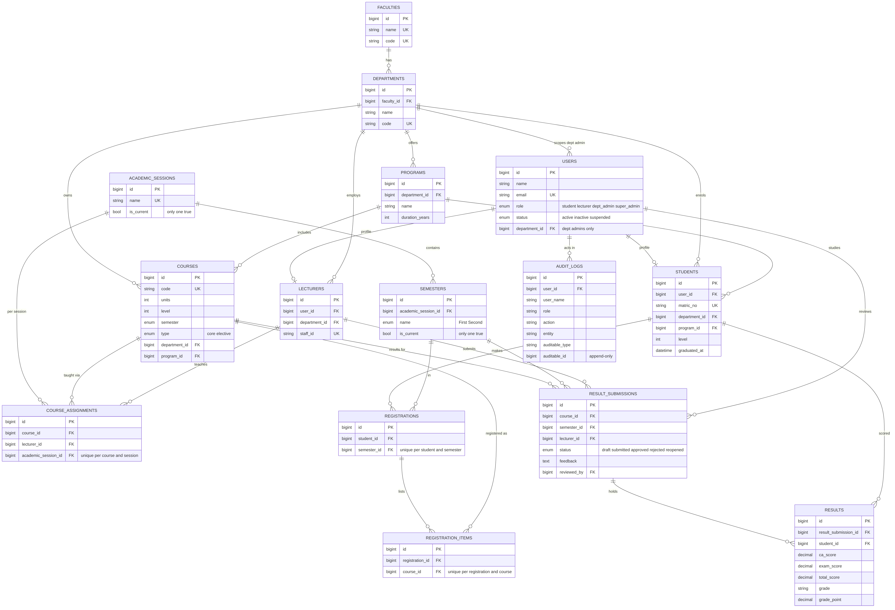

# UEMP: University Education Management Portal

Practical software development test for Lead Web Praxis Media Limited. Four roles (student, lecturer, department admin, super admin) with permissions enforced on the backend.

## Live demo
- **App:** https://uemp-portal.vercel.app
- **API:** https://uemp-api-rjqv.onrender.com (health: `/up`, API base: `/api`)
- The API runs on a free tier and sleeps when idle. The first login can take up to a minute.

## Test credentials
All accounts use the password **`demo123`**.

| Role | Email | Notes |
|---|---|---|
| Super Admin | `superadmin@northstar.edu` | University-wide |
| Department Admin | `deptadmin@northstar.edu` | Computer Science only |
| Department Admin | `h.cooper@northstar.edu` | Economics only |
| Lecturer | `lecturer@northstar.edu` | Dr. Maya Chen (CSC301, CSC305, CSC202) |
| Student | `student@northstar.edu` | Avery Johnson, CSC/2023/001, level 300 |

Seeded demo data: 2 faculties, 3 departments, 4 programs, sessions 2025/2026 and 2026/2027 (current), 7 students, 3 lecturers, 10 courses, registrations and result submissions in every state (draft, submitted, approved, rejected, reopened).

## Quick tour
1. **Lecturer:** open Result entry, CSC202 (rejected, editable), fix scores and submit.
2. **Department admin:** open Result approvals, review CSC301, approve, then reopen. Reject needs feedback.
3. **Student:** open Course registration and register; Results shows approved results only; History shows GPA and CGPA.
4. **Super admin:** Faculties, Departments, Sessions (one current), Users (suspend, change role), Activity log.

## Repository layout
- `frontend/`: React + Vite + TypeScript + Tailwind SPA
- `backend/`: Laravel 13 API (Sanctum, PostgreSQL)
- `docs/`: ER diagram (`er-diagram.png`, `.svg`, `.mmd`), DBML, `TECHNICAL.md`
- `render.yaml`, `backend/Dockerfile`: API deployment; `frontend/vercel.json`: SPA rewrite

Documentation: [`docs/TECHNICAL.md`](docs/TECHNICAL.md) (architecture, database, permissions, security, grading) and the ER diagram below.



## Run locally
Requirements: PHP 8.3+, Composer, Node 20+, a PostgreSQL database (Neon works).

**Backend**
```bash
cd backend
composer install
cp .env.example .env
php artisan key:generate
# edit .env: DB_CONNECTION=pgsql, DB_URL=<your postgres url>, DB_SSLMODE=require
php artisan migrate --seed
php artisan serve          # http://localhost:8000
php artisan test           # 175 tests, uses SQLite in memory
```
With Neon use the direct (unpooled) host; the `-pooler` host breaks migrations.

**Frontend**
```bash
cd frontend
npm install
# create frontend/.env with:
#   VITE_API_URL=http://localhost:8000/api
#   VITE_USE_MOCK=false
npm run dev                # http://localhost:8080
```
Add the frontend origin to `CORS_ALLOWED_ORIGINS` in `backend/.env` if it is not `http://localhost:8080`.

## Environment variables
| Variable | Where | Purpose |
|---|---|---|
| `APP_KEY`, `APP_URL`, `APP_ENV`, `APP_DEBUG` | backend | Laravel basics (`APP_DEBUG=false` in production) |
| `DB_CONNECTION=pgsql`, `DB_URL`, `DB_SSLMODE=require` | backend | PostgreSQL connection |
| `CORS_ALLOWED_ORIGINS` | backend | Comma-separated frontend origins |
| `SEED_PASSWORD` | backend | Password for seeded accounts (default `demo123`) |
| `RUN_SEED` | backend (Render) | `true` re-runs seeders on start; keep `false` |
| `VITE_API_URL` | frontend | API base URL ending in `/api` |
| `VITE_USE_MOCK` | frontend | `false` to use the real API |

## Deployment
- **API (Render):** New > Blueprint > pick this repo. Set `APP_KEY`, `APP_URL`, `DB_URL`, `CORS_ALLOWED_ORIGINS`. The container runs migrations on start.
- **Frontend (Vercel):** import the repo, root directory `frontend`, framework Vite, set `VITE_API_URL` and `VITE_USE_MOCK=false`. Add the Vercel URL to `CORS_ALLOWED_ORIGINS`.

## Security highlights
Sanctum bearer tokens with expiry, role middleware on every route group, department scoping on every dept-admin query, assigned-course checks for lecturers, student queries always scoped to the logged-in student, login rate limiting, suspended accounts signed out immediately, append-only audit log. Details in `docs/TECHNICAL.md`.
